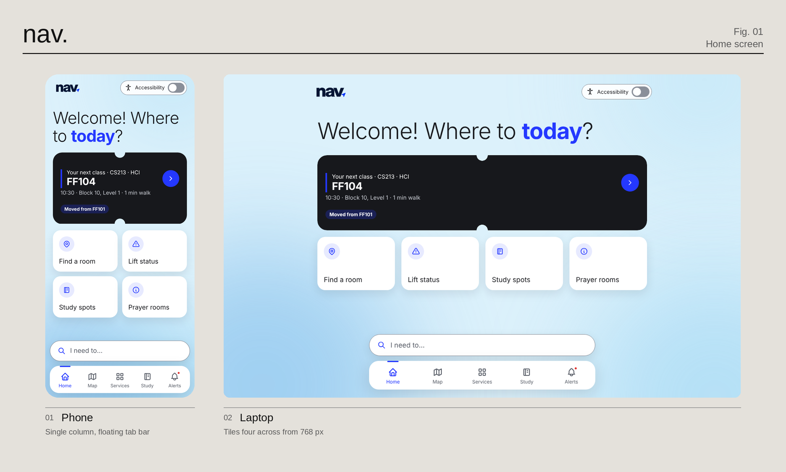
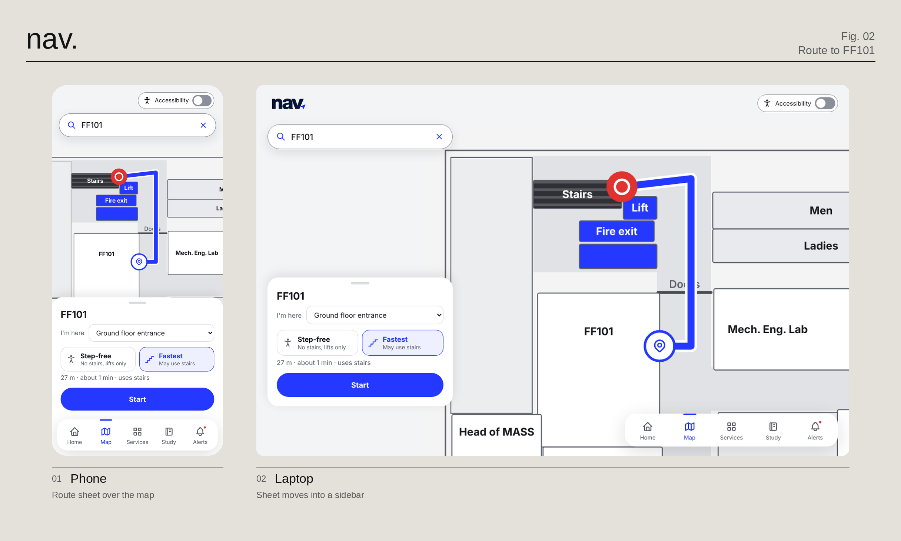

An inclusive campus companion for the British University in Dubai. nav. gets new students, commuters and wheelchair users to the right room by a route that works for them.

**Live app:** https://sadanalshawabkah-cpu.github.io/nav/

 

## Design files

| | Figma |
|---|---|
| Users and roles | [FigJam board](https://www.figma.com/board/QcsJm377nG1e0GnNX0uyee) |
| Strategy and scope | [FigJam board](https://www.figma.com/board/KGuUOvaJCIVBXPkmyeVsHK) |
| Site map | [FigJam board](https://www.figma.com/board/jy80TF3v7kVgSSZLmEQ637) |
| Design system, wireframes and screens | [Figma file](https://www.figma.com/design/i9n0vmHj28I0V77o6FzCVt) |

## How it was thought through

1. **People first.** Students, staff and guests need different things from the same building, so the home screen changes with the role.
2. **One route at the end of every path.** Booking a study room, a class change or a lift outage all hand off to the same route preview, with a step-free toggle. One screen means one place to get accessibility right.
3. **Components before screens.** A Figma library with seven colour modes, including high contrast and colour-blind safe. No status is shown by colour alone.
4. **Tested and redesigned.** Three students finished every task (average ease 4.3 out of 5). Step-free routing was the slowest, so the choice moved into the route sheet where people plan.

## Team

Sadan Alshawabkah and Yara Tageldin, CS213 Human-Computer Interaction, BUiD.
